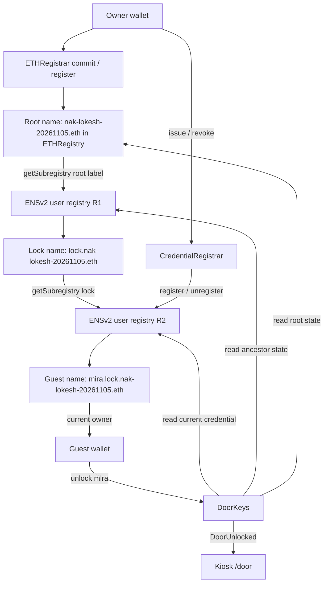

# Names as Keys — project context

Source snapshot: `ce3d7c0080a18adc9bb502816906ab9bce91742f` on local `master`, inspected 2026-11-09 (Asia/Kolkata). Includes the pre-existing untracked synthetic privacy harness. This document grants no execution authority.

Evidence rule: contract behavior below comes from `contracts/src/`; encoding/sequence from `candidate_steps.mjs`, the retained ABIs and machine-readable plans; UI behavior from `frontend/`. Historical observations are labelled and are not fresh chain reads. README and SPIKE were inspected for reconciliation, not used as authority for contract behavior. No RPC query, wallet interaction, build, deployment or test execution was performed to write this file. Compiled artifact metadata source hashes were checked against all current imported sources.

## 1. Idea and three onchain guarantees

An owner controls `<root>.eth` in ETHRegistry, attaches R1, creates `lock.<root>.eth` in R1, attaches R2, and issues `mira.lock.<root>.eth` in R2. `CredentialRegistrar` restricts issuance/revocation to its immutable owner. `DoorKeys.unlock` reads current ENS state and emits an event for the actual credential owner; a kiosk displays the event. Physical actuation is NOT IMPLEMENTED.

1. **Caller authority:** `issue`/`revoke` require `msg.sender == owner`; `unlock` requires `guestRegistry.getOwner(labelId) == msg.sender`, zero credential-resource roles, zero caller root roles, and unemancipated R2.
2. **Current hierarchy authority:** issuance/unlock require active, unexpired root/lock, expected owners and constructor-captured ancestor token generations, factory-verified registries, and both forward attachments. Child expiry cannot exceed lock expiry; lock expiry cannot exceed root expiry.
3. **Bounded issuance and stale-safe revocation:** issuance accepts only complete pristine label state, expiry 60 seconds–30 days from current block time and within the lock, with zero guest roles/resolver/subregistry. Revocation checks the expected current token ID before unregistering. These guarantees assume trusted ENS administrators; they do not prevent an administrator renewing/reissuing/restoring valid current state.

## 2. Architecture and repository layout



```text
./                                  Repository and root configuration/context
├── contracts/                      Foundry project
│   ├── src/                        CredentialRegistrar.sol and DoorKeys.sol
│   │   ├── ens-vendored/           ENSv2 interfaces, role/label libraries; not full implementations
│   │   └── spike/                  shortcut: throwaway SpikeRegistrar experiments
│   ├── test/                       Foundry suites
│   │   ├── spike/                  Original ENS behavior/resolution probes
│   │   ├── stage3/                 Three-level hierarchy fixture
│   │   ├── stage3c/                Registrar/security/admin-lifecycle tests
│   │   ├── stage3d/                DoorKeys tests
│   │   ├── stage3e/                Registration-role readback
│   │   └── workflow/               Ordered 15-action fork fixture
│   ├── script/                     Empty: deployment Solidity script NOT IMPLEMENTED
│   ├── scripts/                    Spike shell/TypeScript utilities
│   │   ├── stage3e/                Manifest preparation, ABI/source/encoding checks
│   │   ├── stage3f_audit/           Read-only chain/source/runtime/role audit tools
│   │   ├── deployment_candidate/   Read-only candidate preparation and owned-fork simulation
│   │   └── deployment_workflow/    Guarded browser review/receipt workflow
│   │       ├── privacy_probe/      shortcut: disposable synthetic privacy harness
│   │       └── test/               Node unit/regression and optional fork/browser tests
│   ├── deployments/                Upstream Sepolia infrastructure inventory
│   ├── lib/                        Vendored forge-std dependency (not project application tests)
│   ├── out/                        Ignored compiled artifacts
│   └── cache/                      Ignored compiler cache
├── frontend/                       Node server, ES modules, owner/guest/kiosk UI and tests
├── docs/                           Historical audits and ENS error notes
│   └── prep/                       Preparation plans, candidate policies and historical stage reports
│       ├── stage3e/                Manifest, ordered sequence, ABI inventory
│       │   └── abis/               Retained upstream/application ABIs
│       ├── stage3f-audit/          Readiness gate reports/plans
│       ├── deployment-candidate/   Approved defaults (not live authorization)
│       ├── workflow/               Guarded workflow implementation record
│       ├── runners/                Evidence collection/redaction helpers
│       └── evidence/               Historical JSON/log/hash/source proof artifacts
```

## 3. Roles and wallets

| Actor | Configured identity | Onchain abilities / limits |
| --- | --- | --- |
| Owner | `0x40F6DcB0Fa311570f72aC6F64045EB80E66711F7` (candidate inputs) | Sends T01–T15; immutable registrar owner alone issues/revokes. R1/R2 registry roles permit administration. Owning the wallet is not a live-write authorization. |
| Guest | `0x5a9191871b9117218F83Ed43293E011667053F39` (candidate inputs) | Current credential owner calls unlock directly. No registrar ownership or intended ENS root/token roles. ERC1155 operator approval does not satisfy msg.sender ownership. |
| CredentialRegistrar | Future contract; see predicted address table | R2 root roles exactly 4097 = REGISTRAR 1 + UNREGISTER 4096 for issuance; revoke needs UNREGISTER via hasRootRoles. No renew/admin role. |
| DoorKeys | Future contract; see predicted address table | Reads ENS and emits DoorUnlocked; receives no ENS roles. No owner-only unlock or actuator method. |
| Kiosk | No configured wallet | Read-only event consumer. Onchain kiosk/relayer authorization API: NOT IMPLEMENTED. |
| Relayer | NOT IMPLEMENTED | No meta-transaction/signature verification API. A different sender cannot unlock on behalf of the credential owner. |

## 4. End-to-end flow

All writes require separate owner/guest approval; this describes code, not permission to execute.

1. Owner registers root: read `isAvailable(string)` and `getRegisterPrice(string,uint64,address)`; if needed `MockUSDC.mint(address,uint256)` and `approve(address,uint256)`; compute `makeCommitment(string,address,bytes32,address,address,uint64,bytes32)`, send `commit(bytes32)`, wait valid age, then `register(string,address,bytes32,address,address,uint64,address,bytes32)`. Capture actual root token ID.
2. Owner creates R1 with `VerifiableFactory.deployProxy(address,uint256,bytes)` encoding `initialize((address,uint256)[])`; attaches via `ETHRegistry.setSubregistry(uint256,address)` and records `R1.setParent(address,string)`.
3. Owner creates lock with `R1.register(string,address,address,address,uint256,uint64)`. Capture lock token ID. Create R2 with the same factory/initializer pattern, then `R1.setSubregistry(uint256,address)` and `R2.setParent(address,string)`.
4. Owner deploys `CredentialRegistrar(address,string,address,address)`, grants `R2.grantRootRoles(uint256,address)` with bitmap 4097, then deploys `DoorKeys(address,string,address,address,uint256)` with epoch 1. Constructors snapshot root/lock generations.
5. Owner calls `CredentialRegistrar.issue(string,address,uint64)`; internally R2 `register` returns the credential token ID. Deployment T15 proposes one day; frontend proposes five minutes.
6. Guest calls `DoorKeys.unlock(string)` with `"mira"`. Valid current ENS state increments `requestNonce` and emits `DoorUnlocked(bytes32,address,bytes32,uint256,uint64,uint256)`.
7. Kiosk reads canonical events with two confirmations; shortcut: display opens for eight seconds by default. No physical-lock transaction occurs.
8. Owner reads current `R2.getState(uint256)`, then calls `CredentialRegistrar.revoke(string,uint256)` with that token ID. Registrar calls `R2.unregister(uint256)` and emits `CredentialRevoked(bytes32,uint256)`.
9. Subsequent guest `unlock("mira")` reverts `InvalidCredential()` because current credential is not REGISTERED / no current owner. Live frontend preflight normally refuses the transaction before any wallet prompt. A reverted transaction emits no denial event.

## 5. Application contracts

ABI spelling below uses compiled external types (`address` for interface-valued parameters/getters). Solidity source constructor types are retained separately. Constants and immutable fields do not consume ordinary storage slots. Neither contract inherits a storage-bearing base, has a fallback/receive function, nor exposes an upgrade/admin setter.

### CredentialRegistrar

Source constructor:

```solidity
constructor(address owner_, string memory rootLabel_, IPermissionedRegistry parent_, IPermissionedRegistry guests_)
```

- `owner_`: nonzero owner of current root and lock; `parent_`: R1; `guests_`: distinct R2. Chain must equal 11155111 and both registry addresses need code. Root label validation and `_requireHierarchy()` run during construction.
- All functions exposed by the compiled ABI (including generated getters):

```solidity
function ETH_REGISTRY() external view returns (address);
function FACTORY() external view returns (address);
function ISSUE_ROLES() external view returns (uint256);
function MAX_DURATION() external view returns (uint64);
function MIN_DURATION() external view returns (uint64);
function REGISTRAR_ROLE() external view returns (uint256);
function ROOT_REGISTRY() external view returns (address);
function SEPOLIA_CHAIN_ID() external view returns (uint256);
function UNREGISTER_ROLE() external view returns (uint256);
function USER_REGISTRY_IMPL() external view returns (address);
function guestRegistry() external view returns (address);
function issue(string label, address guest, uint64 expiry) external returns (uint256 tokenId);
function lockTokenId() external view returns (uint256);
function owner() external view returns (address);
function parentRegistry() external view returns (address);
function revoke(string label, uint256 expectedTokenId) external;
function rootLabel() external view returns (string);
function rootTokenId() external view returns (uint256);
```

`issue(string,address,uint64)` and `revoke(string,uint256)` are `external onlyOwner nonReentrant`. All getters are unrestricted views. `issue` returns `uint256 tokenId`. `revoke` deliberately does not call `_requireHierarchy`: it can clean up the fixed R2 after detachment, but still verifies factory identity and current active generation.

Events (exact names, fields, indexing):

```solidity
event CredentialIssued(bytes32 indexed labelHash, uint256 indexed tokenId, address indexed guest, uint64 expiry);
event CredentialRevoked(bytes32 indexed labelHash, uint256 indexed tokenId);
```

| Custom error | Trigger |
| --- | --- |
| `Unauthorized()` | issue/revoke caller differs from immutable owner. |
| `InvalidConfiguration()` | Constructor wrong chain/zero owner/equal registries/no code; factory verifyContract result differs from USER_REGISTRY_IMPL when implementation is checked. A factory revert propagates instead. |
| `InvalidHierarchy()` | Wrong chain/global eth attachment; root/lock not REGISTERED, expired, lock beyond root, changed ancestor token IDs/owners, or either forward attachment wrong. |
| `InvalidPermissions()` | Issue: registrar R2 root bitmap differs from exactly ISSUE_ROLES or R2 emancipated. Revoke: hasRootRoles(UNREGISTER_ROLE,address(this)) is false. |
| `InvalidGuest()` | Zero, owner or registrar recipient; recipient already has R2 root roles. |
| `InvalidLabel()` | Label byte length outside 3–32; leading/trailing hyphen; any byte outside lowercase ASCII letters, digits, hyphen. |
| `InvalidExpiry()` | Issue expiry below now+60, above now+2592000, or above lock expiry. |
| `LabelAlreadyUsed()` | Prior state not AVAILABLE; nonzero expiry/latestOwner; tokenId not version 0; resource not version 1. This is current-state evidence, not permanent history. |
| `StaleCredential()` | Revoke state not REGISTERED, token ID not expectedTokenId, or expiry <= now. |
| `ReentrantCall()` | entered already true on entry to issue/revoke. onlyOwner executes before this modifier. |
| `RegistryPostconditionFailed()` | After register: wrong status/token/expiry/owner, guest roles, child/resolver; after callback hierarchy recheck, wrong registrar/guest root roles or emancipation. After unregister: still REGISTERED or owner nonzero. The hierarchy recheck itself can revert its own error. |

Storage declarations, in source order:

```solidity
address public immutable owner;
IPermissionedRegistry public immutable parentRegistry;
IPermissionedRegistry public immutable guestRegistry;
uint256 public immutable rootTokenId;
uint256 public immutable lockTokenId;
string public rootLabel; // ordinary storage slot 0; long-string bytes at keccak256(slot)
bool private entered;   // ordinary storage slot 1, byte offset 0
```

Constants: `ETH_REGISTRY`, `ROOT_REGISTRY`, `FACTORY`, `USER_REGISTRY_IMPL`, `SEPOLIA_CHAIN_ID = 11155111`, `REGISTRAR_ROLE = 1`, `UNREGISTER_ROLE = 4096`, `ISSUE_ROLES = 4097`, `MIN_DURATION = 60`, `MAX_DURATION = 30 days`. No guest list/mapping.

ENS calls: `IRegistry.getSubregistry(string)`, `getResolver(string)`; `IPermissionedRegistry.getState(uint256)`, `getOwner(uint256)`, `ROOT_RESOURCE()`, `roles(uint256,address)`, `isEmancipated()`, `register(string,address,address,address,uint256,uint64)`, `hasRootRoles(uint256,address)`, `unregister(uint256)`; `IVerifiableFactory.verifyContract(address)`. Every upstream revert can propagate; application custom errors are not a complete list of possible revert data.

### DoorKeys

Source constructor:

```solidity
constructor(address administrator_, string memory rootLabel_, IPermissionedRegistry parent_, IPermissionedRegistry guests_, uint256 deploymentEpoch_)
```

Same nonzero owner/distinct coded registries/chain/label/current hierarchy preconditions. `deploymentEpoch_` is caller supplied; the contract does not require 1 or enforce uniqueness. The frontend separately requires epoch 1.

All exposed ABI functions:

```solidity
function ETH_REGISTRY() external view returns (address);
function FACTORY() external view returns (address);
function LOCK_LABEL_HASH() external view returns (bytes32);
function ROOT_REGISTRY() external view returns (address);
function SEPOLIA_CHAIN_ID() external view returns (uint256);
function USER_REGISTRY_IMPL() external view returns (address);
function administrator() external view returns (address);
function deploymentEpoch() external view returns (uint256);
function doorId() external view returns (bytes32);
function guestRegistry() external view returns (address);
function lockTokenId() external view returns (uint256);
function parentRegistry() external view returns (address);
function requestNonce() external view returns (uint256);
function rootLabel() external view returns (string);
function rootLabelHash() external view returns (bytes32);
function rootTokenId() external view returns (uint256);
function unlock(string label) external;
```

`unlock(string calldata label) external` is permissionless to call, but only the current qualifying ENS credential owner can succeed. No signature, ERC1155 approval, registrar permission, or administrator bypass substitutes for that owner check. All external calls on its path are view/STATICCALL; it invokes no guest callback.

Events:

```solidity
event DoorUnlocked(bytes32 indexed doorId, address indexed guest, bytes32 indexed credentialLabelHash, uint256 credentialTokenId, uint64 credentialExpiry, uint256 requestNonce);
```

| Custom error | Trigger |
| --- | --- |
| `InvalidConfiguration()` | Constructor wrong chain/zero administrator/equal registries/no code; registry factory verification returns wrong implementation. |
| `InvalidHierarchy()` | Wrong chain or global eth pointer; root/lock inactive/expired, lock expiry beyond root, changed captured token IDs/owners, or wrong forward attachments. |
| `InvalidCredential()` | Credential not REGISTERED, expiry <= now or >lock expiry, getOwner != msg.sender, roleCount(resource) !=0, caller R2 root roles !=0, or R2 emancipated. |
| `InvalidLabel()` | Same 3–32 byte lowercase ASCII/digit/hyphen rules as registrar. |

Storage declarations:

```solidity
address public immutable administrator;
IPermissionedRegistry public immutable parentRegistry;
IPermissionedRegistry public immutable guestRegistry;
bytes32 public immutable rootLabelHash;
uint256 public immutable rootTokenId;
uint256 public immutable lockTokenId;
uint256 public immutable deploymentEpoch;
bytes32 public immutable doorId;
string public rootLabel;     // ordinary storage slot 0
uint256 public requestNonce; // ordinary storage slot 1; initially 0; increments before event
```

Constants: shared ENS addresses and chain above; `LOCK_LABEL_HASH = keccak256("lock")`. `doorId = keccak256(abi.encode(block.chainid,address(this),rootLabelHash,LOCK_LABEL_HASH,parent_,guests_,rootTokenId,lockTokenId,deploymentEpoch_))`.

ENS interfaces called: `IRegistry.getSubregistry(string)`; `IPermissionedRegistry.getState(uint256)`, `getOwner(uint256)`, `roleCount(uint256)`, `roles(uint256,address)`, `ROOT_RESOURCE()`, `isEmancipated()`; `IVerifiableFactory.verifyContract(address)`. No resolver call participates in authorization. Storage slots above follow the source declarations and Solidity layout; existing artifacts do not include a `storageLayout` field.

## 6. ENSv2 usage

- Infrastructure addresses: complete configured inventory in section 11. Application contracts hardcode RootRegistry, ETHRegistry, VerifiableFactory, UserRegistryImpl and Sepolia chain ID. No application call to ETHRegistrar, resolver or ERC20 occurs after construction; those belong to setup tooling.
- `IStandardRegistry`, `IPermissionedRegistry`, `IRegistry`, `IEnhancedAccessControl`, `IVerifiableFactory`, `IETHRegistrar`, `IETHRenewer`, `IERC20`/`IMockERC20`, `IEACGrantInitializable`/`Grant` provide deployment APIs. Spike/resolution utilities additionally use `IPublicResolverV2`, `IUniversalResolver`, `IPermissionedResolverInitializable`, `IAddressSetter`, `IUnsafeTransferable` and ERC1155 interfaces.
- R1/R2: `deployProxy(address implementation,uint256 salt,bytes data)`, initializer `initialize((address,uint256)[])` with `Grant { address account; uint256 roleBitmap; }` for the explicit owner. `predictProxyAddress(address,uint256)` is caller/salt-bound. `prediction.mjs` independently reproduces the pinned clone runtime/CREATE2 construction using factory `proxyLogic()`; factory verification is not a substitute for full runtime/immutable checks.
- Owner initial root bitmap: `380593917518227438537563280301172632627253505` = operations 1118465 plus those operations shifted 128. Lock token bitmap: `91700664256357922357994873537130062512592519168`. Root registration bitmap: `97409655027181761882228017414928043058140282880`. Source checks: `RegistryRolesLib.sol`, archived ETHRegistrar source and `security_policy.mjs`.
- `LibLabel.id(label) = uint256(keccak256(bytes(label)))`; `withVersion(anyId,versionId) = anyId ^ uint32(anyId) ^ versionId`. Low 32 bits hold version information. Do not equate a name's labelhash with its current token ID. Role changes can regenerate token IDs without changing the registration resource; ancestor snapshots deliberately detect that.

Exact registry state shape:

```solidity
enum Status { AVAILABLE, RESERVED, REGISTERED }
struct State {
    Status status;
    uint64 expiry;
    address latestOwner;
    uint256 tokenId;
    uint256 resource;
}
```

Issue requires `AVAILABLE`, expiry 0, latestOwner zero, token version 0 and resource version 1. Unlock follows current guest ownership/generation, not a captured guest token. Root and lock generations are captured in each application constructor. `getParent()` metadata is written/verified by tooling; application authorization checks forward attachments and does not itself read canonical parent metadata.

Commit/reveal APIs (ABI canonical types):

```text
makeCommitment(string,address,bytes32,address,address,uint64,bytes32) -> bytes32
commit(bytes32)
commitmentAt(bytes32) -> uint64
MIN_COMMITMENT_AGE() -> uint64
MAX_COMMITMENT_AGE() -> uint64
getRegisterPrice(string,uint64,address) -> (uint256 base,uint256 premium)
register(string,address,bytes32,address,address,uint64,address,bytes32) -> uint256
```

`CandidateReview.commitmentForReview` hashes `abi.encode(label,owner,secret,subregistry,resolver,duration,referrer)`; payment token is not in the commitment. Live secrets use browser CSPRNG, memory only. Reveal requires current timestamp >= committedAt+minimum and < committedAt+maximum; read both getters fresh. Retained source/evidence gives minimum 60 seconds, maximum 86400 seconds; root duration 31536000 seconds. Fresh current timing/quote: UNKNOWN without RPC. Candidate pays MockUSDC, 6 decimals, max rent 8100000 units, exact deficit mint and exact quote allowance. Recorded T01/T02 amount: 8000021 units. No fixed-price promise; changed quote blocks. Resolver/subregistry arguments for initial root and lock are zero; no resolver is required to unlock.

## 7. T01–T15 deployment sequence

Authority: `candidate_steps.mjs` builds live prerequisites and exact receipt assertions; `fresh-preflight/review-plan.json` supplies retained candidate bindings. `docs/prep/stage3e/DEPLOYMENT_SEQUENCE.md` and `deployment-manifest.json` are historical preparation artifacts, not a current journal.

Notation: O=owner, G=Mira, L=`nak-lokesh-20261105`, Z=zero address, B32Z=zero bytes32; P=fresh exact quote (recorded 8000021); RT/LT=receipt-derived current root/lock token IDs; I=UserRegistryImpl; init=owner Grant initializer; eL=review timestamp+7776000; eG=review timestamp+86400. Every sender below is O; chain 11155111 and ETH value 0 for every row. All rows require current identities, nonce/fee/funding/freshness checks and confirmed preceding included steps. All CONFIRMED labels below are historical local evidence, not a new RPC verification.

| Step | Action | Exact contract/function | Inputs | Sender | Prerequisites | Expected event/state | Onchain verification | Current evidence status |
| --- | --- | --- | --- | --- | --- | --- | --- | --- |
| T01 | Obtain rent tokens | MockUSDC `mint(address,uint256)` | (O, P−balance), only if deficient | O (owner) | Available root, exact quote, correct token runtime | Transfer(Z,O,deficit); balance reaches P | Receipt + exact Transfer log; balanceOf(O) at receipt block | CONFIRMED `0xa165ec5b2657632ffb3cf81e030b7e4dcf9e6fbf902300d58e5fd6c6071eeb7f` |
| T02 | Bounded allowance | MockUSDC `approve(address,uint256)` | (ETHRegistrar,P), only if allowance differs | O (owner) | Funded P; T01 if included | Approval(O,ETHRegistrar,P) | Exact log; allowance(O,ETHRegistrar)==P at receipt block | CONFIRMED `0xc4c06ecb5b793673448e6f18ebafab21db8eb3b636a9bccd861fc784d4db5c33` |
| T03 | Commit root | ETHRegistrar `commit(bytes32)` | (fresh commitment); preimage not exported | O (owner) | T01/T02 verified; balance>=P; allowance==P; commitmentAt==0; T04 confidentiality must be resolved first | CommitmentMade; commitmentAt equals mined timestamp | Exact receipt/log; commitmentAt(commitment) | NOT EXECUTED; next sequential step, not authorized |
| T04 | Reveal root | ETHRegistrar `register(string,address,bytes32,address,address,uint64,address,bytes32)` | (L,O,private secret,Z,Z,31536000,MockUSDC,B32Z) | O (owner) | Canonical T03; valid age; same commitment; available root; exact price/funding/allowance; confidentiality BLOCKED | NameRegistered, LabelRegistered and complete registry/token logs; rent Transfer; commitment consumed | Exact ordered logs; ETHRegistry.getState/getOwner, root roles and expiry; commitmentAt==0 | NOT EXECUTED; HARD BLOCKED |
| T05 | Create R1 | VerifiableFactory `deployProxy(address,uint256,bytes)` | (I, approved R1 salt, init) | O (owner) | Verified root and unused predicted R1; pinned factory/logic/implementation | ProxyDeployed, Upgraded, RegistryCreated, EACRolesChanged, URIUpdated, Initialized | Receipt address; verifyContract; runtime; exact owner root bitmap and roleCount | NOT EXECUTED |
| T06 | Attach R1 | ETHRegistry `setSubregistry(uint256,address)` | (RT,R1) | O (owner) | Current root generation/owner; no existing child; attachment role | SubregistryUpdated | getSubregistry(L)==R1; token generation unchanged | NOT EXECUTED |
| T07 | R1 metadata | R1 `setParent(address,string)` | (ETHRegistry,L) | O (owner) | R1 verified; SET_PARENT authority | ParentUpdated | R1.getParent()==(ETHRegistry,L), forward link retained | NOT EXECUTED |
| T08 | Register lock | R1 `register(string,address,address,address,uint256,uint64)` | ("lock",O,Z,Z,91700664256357922357994873537130062512592519168,eL) | O (owner) | Available lock; eL within root; proper register role | LabelRegistered, TokenResource and exact receipt events; LT captured | getState/getOwner/getExpiry; exact token roles; no child yet | NOT EXECUTED |
| T09 | Create R2 | VerifiableFactory `deployProxy(address,uint256,bytes)` | (I, approved distinct R2 salt, init) | O (owner) | Active lock/root; predicted R2 empty | Factory/initialization logs as T05 | verifyContract/runtime; owner roles/count; unemancipated | NOT EXECUTED |
| T10 | Attach R2 | R1 `setSubregistry(uint256,address)` | (LT,R2) | O (owner) | Current lock/root generations; existing child zero; attachment role | SubregistryUpdated | R1.getSubregistry("lock")==R2; LT unchanged | NOT EXECUTED |
| T11 | R2 metadata | R2 `setParent(address,string)` | (R1,"lock") | O (owner) | Factory identity; SET_PARENT authority | ParentUpdated | R2.getParent()==(R1,"lock"); both forward links | NOT EXECUTED |
| T12 | Deploy registrar | CredentialRegistrar `constructor(address,string,address,address)` | (O,L,R1,R2) | O (owner) | Full active bounded hierarchy; stable ancestor generations; expected empty CREATE address | Code at receipt.contractAddress; no application constructor event | Full runtime with immutables; owner/label/registry/token getters | NOT EXECUTED |
| T13 | Grant issuer | R2 `grantRootRoles(uint256,address)` | (4097,CredentialRegistrar) | O (owner) | Owner admin roles; registrar config proven; previous registrar roles zero | EACRolesChanged | roles(0,registrar)==4097; exact aggregate role counts; not emancipated | NOT EXECUTED |
| T14 | Deploy door | DoorKeys `constructor(address,string,address,address,uint256)` | (O,L,R1,R2,1) | O (owner) | Full active hierarchy; stable generations; expected empty CREATE address | Code; no application constructor event; requestNonce=0 | Full runtime/immutable getters; doorId formula; no DoorKeys ENS roles | NOT EXECUTED |
| T15 | Issue guest | CredentialRegistrar `issue(string,address,uint64)` | ("mira",G,eG) | O (owner) | Pristine R2 state; exact issuer 4097; zero guest roles; expiry margin>=600; bounded ancestors | CredentialIssued plus exact registry events; current guest ownership | getState/getOwner/getExpiry; roleCount(resource)==0; no child/resolver; unlock eth_call from G | NOT EXECUTED |

T04 blocker: `candidate.mjs` refuses T04 wallet execution even with matching GO authorization and live flag. MetaMask may send unrevealed calldata to RPC estimation, previews, remote simulation or telemetry before approval. Loopback estimation/redaction do not prove extension confidentiality. The untracked probe establishes only synthetic local instrumentation; its saved report remains INCONCLUSIVE. Reported MetaMask 13.55.0 / Brave 1.99.55 are owner-supplied configuration, not independently measured evidence. Do not start a live commitment before the reveal boundary is reviewed.

Reconciliation / mismatches:

| Historical artifact | Current code/evidence difference |
| --- | --- |
| DEPLOYMENT_SEQUENCE opening says no transactions submitted; manifest transactionHash/receipt fields null | Retained local journal contains confirmed T01/T02. Historical manifest must not be rewritten or treated as journal authority. |
| Manifest/sequence owner, guest, salts, future addresses unresolved | Candidate inputs bind owner/Mira, public salts and conditional predictions. Receipt-derived addresses still absent for T05 onward. |
| Manifest null secret/commitment and absolute expiry fields | Correctly deferred; candidate runner fills only in memory/from verified receipts and identified timestamps. Never fill the shared manifest with a secret. |
| Candidate plan includes T01/T02 and nonce prefix starting 0x32 | Historical prefix includes already executed actions; do not recompute the remaining sequence by blindly dropping them or reuse stale packet freshness. Reconcile the existing journal. |
| T15 one-day expiry versus frontend five-minute issuance | Explicit implementation difference: candidate default 86400 seconds; live adapter head.timestamp+300. Neither silently renews/reuses mira. |
| Old SPIKE role discussion | Actual RegistryRolesLib ROLE_CAN_TRANSFER_ADMIN is `(1 << 28) << 128`, not an ordinary bit-28 operation role. Stage 3B/C/D implement ancestor checks missing in the old canUnlock probe. |

Receipt verification for every executed step: successful canonical receipt, exact mined sender/nonce/destination/value/calldata/gas/fees, exact ordered logs, identified-block historical postconditions, >=12 latest-head confirmations AND separate finalized coverage, fresh canonical current-state checks. Event names above are summaries; `candidate_steps.mjs` builds the complete emitter/order/argument assertions, including LabelStore and registry events. No real guest unlock is included in T01–T15.

## 8. Tests and exact commands

Commands below are instructions, not tests run for this document. Repository root is the working directory unless a command explicitly changes it. Export SEPOLIA_RPC_URL privately; never paste credential-bearing values into evidence. `contracts/foundry.toml`: solc 0.8.25, Cancun, optimizer 200, via_ir=false, fuzz runs 16; dependencies in contracts/lib. Install dependencies only when authorized; no install was performed here.

All project Solidity test files:

| File | Coverage from test bodies/assertions | Sepolia fork block | Command |
| --- | --- | --- | --- |
| `contracts/test/spike/ClosureA3Lite.t.sol` | Transfer-capable control, zero-role safe/unsafe transfer denials, no emancipation, self-grant denial; inherits spike tests. | 12071220 (external selected reproducible baseline; not an assertion in every suite) | `forge test --root contracts --fork-url sepolia --fork-block-number 12071220 --match-contract ^ClosureA3LiteTest$ --match-test testA3Lite` |
| `contracts/test/spike/ENSv2Questions.t.sol` | Commit/reveal/price, factory/roles, resolver, owner/expiry/revoke/reuse, parent lifecycle, permissions, event/label probes; shortcut: permissive SpikeRegistrar and deterministic fork secrets. | 12071220 (external selected reproducible baseline; not an assertion in every suite) | `forge test --root contracts --fork-url sepolia --fork-block-number 12071220 --match-contract ^ENSv2QuestionsTest$` |
| `contracts/test/spike/SepoliaDeploymentSmoke.t.sol` | Infrastructure code presence, chain ID and universal resolver isENSv2. | 12071220 (external selected reproducible baseline; not an assertion in every suite) | `forge test --root contracts --fork-url sepolia --fork-block-number 12071220 --match-contract ^SepoliaDeploymentSmokeTest$` |
| `contracts/test/stage3/ThreeLevelENSv2.t.sol` | Root→lock→guest attachment/metadata/ownership/expiry, ancestor generations, role churn, transfers/emancipation; shortcut: fixture acceptance oracle, direct registry issuance. | 12071220 (external selected reproducible baseline; not an assertion in every suite) | `forge test --root contracts --fork-url sepolia --fork-block-number 12071220 --match-contract ^ThreeLevelENSv2Test$` |
| `contracts/test/stage3c/CredentialRegistrar.t.sol` | Owner restrictions, exact roles, expiry/label bounds, pristine state, stale generation, callback/reentrancy, detachment cleanup, postconditions, wrong chain/implementation/read failures. | 12071220 (external selected reproducible baseline; not an assertion in every suite) | `forge test --root contracts --fork-url sepolia --fork-block-number 12071220 --match-contract ^AttackingGuestReceiver$` |
| `contracts/test/stage3c/FinalArchitectureCorrections.t.sol` | Reachable/defensive state matrix, residual expired ownership, admin revival/delegation, minimal-registrar limits, factory identity versus runtime. | 12071220 (external selected reproducible baseline; not an assertion in every suite) | `forge test --root contracts --fork-url sepolia --fork-block-number 12071220 --match-contract ^AtomicExpiredCleanupProbe$` |
| `contracts/test/stage3c/SecurityPreflight.t.sol` | Restricted caller, guest/operator permissions, emancipation/revocation capability, transfer approvals and generation reuse. | 12071220 (external selected reproducible baseline; not an assertion in every suite) | `forge test --root contracts --fork-url sepolia --fork-block-number 12071220 --match-contract ^RestrictedRegistrarProbe$` |
| `contracts/test/stage3d/DoorKeys.t.sol` | Event/identity/nonce, owner/operator denials, status/expiry/ancestor bounds, attachments/generations, admin renew/reissue, roles/emancipation, malformed reads and STATICCALL invariants. | 12071220 (external selected reproducible baseline; not an assertion in every suite) | `forge test --root contracts --fork-url sepolia --fork-block-number 12071220 --match-contract ^UnlockingGuest$` |
| `contracts/test/stage3e/RegistrationRoleReadback.t.sol` | Registration/init role bitmaps and source policy readback. | 12071220 (external selected reproducible baseline; not an assertion in every suite) | `forge test --root contracts --fork-url sepolia --fork-block-number 12071220 --match-contract ^RegistrationRoleReadbackTest$` |
| `contracts/test/workflow/OrderedDeploymentWorkflow.t.sol` | shortcut: local fork ordered fifteen owner actions and hierarchy; explicit block assertion 12071963. | 12071963 (asserted) | `forge test --root contracts --fork-url sepolia --fork-block-number 12071963 --match-contract ^OrderedDeploymentWorkflowTest$` |

Stage 3C/D/E suites inherit the ThreeLevelENSv2 fixture, so matching a contract can also run inherited tests. Spike smoke/questions accept an externally chosen fork; no fixed block assertion exists there. 12071220 is the retained reproducibility baseline, not a guarantee that fresh chain state will behave identically.

```sh
# All project Solidity tests except ordered workflow:
forge test --root contracts --fork-url sepolia --fork-block-number 12071220 --no-match-contract OrderedDeploymentWorkflowTest
# Ordered fixture uses its own audit snapshot:
forge test --root contracts --fork-url sepolia --fork-block-number 12071963 --match-contract OrderedDeploymentWorkflowTest
# Original spike runner (loads ignored env; fork head unless configured externally):
(cd contracts && bash scripts/run-spike.sh)
```

Node/Python test files and supporting test fixtures:

| File | Coverage | Command |
| --- | --- | --- |
| `frontend/test.mjs` | HTTP lifecycle/routing/QR, expiry/status, unconfigured Sepolia fail-closed, event canonicality/nonce, trusted-click/wrong-chain/rejection and prepared issue/revoke wallet mocks. | `node --test frontend/test.mjs` |
| `contracts/scripts/deployment_candidate/test.mjs` | Conditional CREATE nonces, frozen public candidate/deferred inputs, read-only proxy/preimage filters, CREATE2 reproduction. | `node --test contracts/scripts/deployment_candidate/test.mjs` |
| `contracts/scripts/deployment_candidate/review_regressions.mjs` | Exact deficit, freshness/nonce/guest margin/gas ceilings, frozen envelope/sender/constructor address/mined transaction binding, provenance substitutions. | `node --test contracts/scripts/deployment_candidate/review_regressions.mjs` |
| `contracts/scripts/deployment_workflow/test/workflow.test.mjs` | Packet review, disabled writes, budgets/identity/attempt persistence, duplicates/rejection/uncertain/pending/replacements/cancellation, exact events, reorgs, latest versus finalized state. | `node --test contracts/scripts/deployment_workflow/test/workflow.test.mjs` |
| `contracts/scripts/deployment_workflow/test/connection.test.mjs` | No page-load account prompt; trusted click, selected owner/chain, no sign/send, context changes. | `node --test contracts/scripts/deployment_workflow/test/connection.test.mjs` |
| `contracts/scripts/deployment_workflow/test/candidate.test.mjs` | Real candidate preparation/recovery; T01 intent and one hashless retry; T02 retained envelopes; T04 hard block; optional Playwright trusted-click regressions. | `node --test contracts/scripts/deployment_workflow/test/candidate.test.mjs` |
| `contracts/scripts/deployment_workflow/test/private.test.mjs` | Loopback origin/redirect/cache restrictions, exact reveal envelope, private estimate response redaction, upstream secret filtering. | `node --test contracts/scripts/deployment_workflow/test/private.test.mjs` |
| `contracts/scripts/deployment_workflow/test/privacy-probe.test.mjs` | shortcut: public marker detection, local simulation/read allowlist, write blocking, mock injected wallet rejection. | `node --test contracts/scripts/deployment_workflow/test/privacy-probe.test.mjs` |
| `contracts/scripts/deployment_workflow/test/privacy-validation.test.mjs` | shortcut: random synthetic ABI fixture, HTTP redaction/origin/write blocking/wrong-chain guard, VM preparation and rejection lifecycle. Untracked, not imported by all.mjs. | `node --test contracts/scripts/deployment_workflow/test/privacy-validation.test.mjs` |

```sh
npm --prefix frontend test
npm --prefix contracts/scripts/deployment_workflow test
# Include the untracked new privacy suite explicitly:
node --test contracts/scripts/deployment_workflow/test/privacy-validation.test.mjs
python3 -B -m unittest discover -s contracts/scripts/stage3e -p 'test_*.py' -v
python3 -B -m unittest discover -s contracts/scripts/stage3f_audit -p 'test_*.py' -v
```

- `stage3e/test_prepare.py`: 15-step ABI/arguments/events, initializer roles, compiler ABI equality, unresolved input handling, read-only clients/no wallet imports.
- `stage3e/test_encoding_audit.py`: independent encoding, tuple/event/constructor layout, role policy, binding/target tampering, four verification layers.
- `stage3f_audit/test_audit.py`: method allowlist, retained T01/T02 simulations, full semantic runtime/immutable reconciliation, corrupt-runtime detection, LabelStore/ancestor proofs and role census. Requires retained `/tmp/nak-stage3f-reproduced.json` for corruption test; recreate with `python3 -B contracts/scripts/stage3f_audit/compile_sources.py --output /tmp/nak-stage3f-reproduced.json --solc /absolute/path/to/matching/solc` after locating the compiler whose recorded hash matches. Portable compiler location: UNKNOWN; supply the matching solc path. This compiler tool writes an evidence stderr file: do not run during read-only work.
- `deployment_workflow/test/all.mjs`: imports workflow, connection, candidate, private, original privacy tests. `fixture.mjs`: shared mock provider/packets, not a suite.
- `deployment_workflow/test/owned-fork-verification.mjs`: opt-in `node contracts/scripts/deployment_workflow/test/owned-fork-verification.mjs`; real owned local fork using reviewer-corrections observation.blockNumber/hash; verifies HTTP private estimator and failure paths. Requires historical upstream RPC availability and Anvil; writes only to owned local node.
- `deployment_candidate/simulate.mjs --candidate-workflow`: opt-in ordered owned-fork integration, not a node:test suite. Uses retained reviewer-corrections block/hash, currently 12073440; writes evidence files and local fork state. Not a public deployment command.
- `privacy_probe/smoke.mjs`: opt-in synthetic local instrumentation runner, chain 31338, no fork, no wallet, all broadcasts blocked.
- `seed-anvil-resolution.ts` / `resolve-test.ts` are integration utilities, not node:test suites. `resolve-test.ts` compares ethers resolveName and direct universal resolver results for configured ENS_TEST_NAME/ENS_EXPECTED_ADDRESS. `seed-anvil-resolution.ts` impersonates/funds a local Anvil sender and seeds resolution state; shortcut: local-only state changes and deterministic fixture preimage. Do not run against a public endpoint.
- `docs/prep/runners/run-evidence.sh`, `run-a6-pair.sh`, `redact.py` wrap historical evidence capture; logs/patches and prior-source copies under evidence are historical, not additional active suites. `contracts/lib/forge-std/test` is upstream dependency coverage, not application coverage.

Known gaps: installed MetaMask full lifecycle/egress confidentiality, real project Sepolia deployment and frontend E2E, physical actuator, production network fault/security audit, persistent recovery of frontend pending hashes across reloads, multiple doors/guests, renewal/replacement UI. Mock/fork PASS is not live proof. Browser candidate regressions require PLAYWRIGHT_MODULE and CHROMIUM_PATH; absent configuration skips them. No suite was rerun for this documentation-only task.

## 9. Frontend

| Route/module | Behavior |
| --- | --- |
| `/`, `/owner` | Owner dashboard, issue five-minute credential, revoke active expected token, status/activity and QR. |
| `/guest` | Requires exact server door context query; demo includes mode, live includes door/chain/contract; connects configured guest and preflights unlock. |
| `/door` | Read-only kiosk/event display, no wallet needed. |
| `/api/state`, `/api/prepare` | Server-side ENS reads and unsigned calldata preparation; server never signs. |
| `/api/action`, `/api/reset` | shortcut: demo-only synthetic action/reset HTTP APIs; forbidden in live mode. |
| `/qr.svg` | QR to exact guest URL; unavailable without valid live deployment config. |
| `demo.mjs` | shortcut: one shared disposable RAM session, role-selector wallets, synthetic root/lock/credential/events, no EVM or real signatures. Reset clears session. |
| `sepolia.mjs` | Actual ethers JSON-RPC/contract reads, runtime/receipt/config validation; unsigned issue/revoke/unlock data and staticCall preflights. |
| `live-wallet.mjs`, `app.mjs` | Trusted click, MetaMask, selected sender/chain/context validation, ABI target/label checks, eth_sendTransaction, two-confirmation wait with 120-second timeout. Pending hash blocks writes in that tab; no durable attempt journal here. |

Live startup requires HTTPS public origin, server RPC, actual DoorKeys/registrar addresses, runtime hashes, T14 receipt hash, distinct owner/Mira wallets and exact guest URL. Checks successful canonical T14 receipt, creation address/sender, code hashes, root label, owner/registries/ancestor generations and epoch 1. Startup requires only two confirmations, not the Stage 3F twelve-plus-finalized policy; deployment must already have passed its stricter checks. Missing/failed config exposes ready=false and disables actions/QR.

Kiosk algorithm: filter DoorUnlocked by configured contract and doorId; read head and scan only through head−1 (two confirmations including event block). Query up to 2000 blocks at a time, walk older windows if nonce indicates a missed event, compare log requestNonce against `door.requestNonce` at confirmed block, verify event block hash canonical. No pending wallet status opens the kiosk. shortcut: latest event presentation relocks after NAK_OPEN_SECONDS (default 8), not an actuator signal; requestNonce is an event sequence, not a proximity challenge. Polling is server/client reads, not subscription-based physical actuation.

Demo needs no chain env; live needs all NAK_* deployment fields in section 11. Hardcoded `ROOT = 'nak-lokesh-20261105'`, `LABEL = 'mira'`, `CHAIN = 11155111` in protocol.mjs. Arbitrary label selection is NOT IMPLEMENTED.

## 10. Deployment workflow tooling

| Component | Responsibility / guard |
| --- | --- |
| `build.mjs` / `candidate_bundle.mjs` | Bundle reviewed source/ABIs/artifacts/inputs/evidence into `/tmp/nak-local-deployment-review`; ordinary source flag remains false. Rebuilding overwrites local dashboard files. |
| `serve.mjs` / `browser.mjs` | Loopback 127.0.0.1:8769 review UI; reads local authorization per request; prepares/revalidates separately from trusted wallet Request click. |
| `workflow.mjs` | ABI re-encoding, exact canonical quantity/envelope/target/create address validation, event decoding/order, state and runtime reads, fee/gas/budget/freshness/nonce policy. ReadOnlyWallet refuses signing/writes/permission prompts. |
| `candidate.mjs` / `candidate_steps.mjs` | Sequential receipt-derived bindings, per-step preconditions and exact receipt/current-state verification; explicit T01 intent or exact step authorization; T04 independent hard block. |
| Attempt/journal | Public schema/plan/packet/review digests, anchors, receipt evidence and transitions. Persist attempt lock before wallet call, coordinate Web Locks, prevent duplicate/concurrent retry, retain rejected/uncertain/pending/replaced evidence. Never discard a journal to retry. |
| Recovery | Reconstruct at original identified block, compare digests, reverify actual receipt/envelope/events/state. One explicitly reviewed T01 hashless-rejection retry supported; requesting/uncertain/hash-bearing cases do not qualify. |
| `private_server.mjs` / `private_transport.mjs` | Reveal estimation only through same-origin loopback owned disposable Anvil with pinned block/envelope and read-only preimage-filtered upstream; generic errors and gas quantity only. Does not establish wallet egress confidentiality. |
| `deployment_candidate/` | Read-only inspect/prepare/derive, role/source policy checks, independent CREATE2/conditional CREATE, controlled local fork integration. Some commands write evidence; inspect code before running. |
| `privacy_probe/` | shortcut: synthetic calldata transport observation, no real project secret, controlled local RPC write denylist/allowlist; not clearance for T04. |

Current source `LIVE_EXECUTION_ALLOWED = false`; `T01_AUTHORIZATION = null`. Ignored local step authorization is GO for T02 only; no copy of that authorization is included here. The pre-existing built dashboard may differ from source; do not infer its gate state from HEAD. Browser journal key is `nak-candidate:` plus bundle digest. Hashes detect mismatch, not malicious storage rewriting plus recomputed hashes. Preimage loss blocks unrevealed reveal; prior commitment must be reconciled and expire before a separately reviewed replacement.

**What can be skipped with a throwaway testnet key?** Code contains no throwaway-key bypass. T01/T02 may be conditionally omitted only when verified balances/exact allowance make them unnecessary; doing so affects CREATE nonce predictions. shortcut: on an owned disposable local fork, mock finality/time, impersonation and fixture substitutions are explicit test-only seams. No existing authority permits skipping T04 confidentiality, chain/account/target checks, transaction review, nonce/fee limits, journal locks, or receipt verification on public Sepolia. A lower confirmation/finality policy would require an explicit separate policy/code review, not an undocumented contributor shortcut.

## 11. Networks, addresses and environment

| Network | Chain ID | Purpose |
| --- | --- | --- |
| Sepolia | 11155111 / 0xaa36a7 | Hardcoded application deployment/runtime chain. |
| Owned Sepolia fork | 11155111 | shortcut: local fixture mimics Sepolia chain identity; not a public deployment. |
| Disposable privacy node | 31338 / 0x7a6a | shortcut: no fork, synthetic non-production payload observation. |
| Mainnet | NOT IMPLEMENTED | Application constructors reject a different chain. |

Configured infrastructure inventory below is copied exactly from deployment-manifest. Classification is **historically recorded upstream**, not fresh liveness/source-verification proof. Resolvers/MockDAI/wrapper/batch entries are inventory/spike dependencies, not required DoorKeys authorization inputs.

| Name | Exact address | Classification / use |
| --- | --- | --- |
| ETHRegistry | `0xd4ebcbbdf463c9c45784603db0ddd499bc44a8b4` | Historical upstream Sepolia; manifest observation block 12071722 |
| ETHRegistrar | `0xf633e7fc17e2bbe0d0965d18ec1821dcb754a3d3` | Historical upstream Sepolia; manifest observation block 12071722 |
| RootRegistry | `0xb458d6a3a77919449d03e7a6903c26827c1ec43f` | Historical upstream Sepolia; manifest observation block 12071722 |
| UpgradableUniversalResolverProxy | `0xeEeEEEeE14D718C2B47D9923Deab1335E144EeEe` | Historical upstream Sepolia; manifest observation block 12071722 |
| ManagedUniversalResolverProxy | `0x6d80F2172CFdEc5730fE683860C33d26fC42e6F1` | Historical upstream Sepolia; manifest observation block 12071722 |
| UniversalResolverV2 | `0x24e1d8e068620b647ca097f961a61055f4f42d72` | Historical upstream Sepolia; manifest observation block 12071722 |
| VerifiableFactory | `0xda70306c98e97ece36f997a21368e53298572991` | Historical upstream Sepolia; manifest observation block 12071722 |
| UserRegistryImpl | `0x9bd8a88719068d09ecee662f36c0e3856708366a` | Historical upstream Sepolia; manifest observation block 12071722 |
| PermissionedResolverImpl | `0x115eb53f0c60696633855f90b138178fb40b2b2c` | Historical upstream Sepolia; manifest observation block 12071722 |
| PublicResolverV2 | `0xdc4a563d00f5c3012b699794eb9e13a561be386f` | Historical upstream Sepolia; manifest observation block 12071722 |
| StandardRentPriceOracle | `0x8196665d4ca7488b6474a9ec8e7d2719fb42263a` | Historical upstream Sepolia; manifest observation block 12071722 |
| MockUSDC | `0x240b0316df57887dbbe58b586508b19e633a14aa` | Historical upstream Sepolia; manifest observation block 12071722 |
| MockDAI | `0xf6fac8a58a0be13b9197f27c41b73162fe32572b` | Historical upstream Sepolia; manifest observation block 12071722 |
| LabelStore | `0xed8246ff02203a4d4cb262bd78beaa7408a57cae` | Historical upstream Sepolia; manifest observation block 12071722 |
| WrapperRegistryImpl | `0xbe768b63e5fbbfbb0ae97e9064e0002df8001880` | Historical upstream Sepolia; manifest observation block 12071722 |
| BatchRegistrar | `0x4a4c8b7cdab6b19dc2cdb417cdb53a2ccbaf5322` | Historical upstream Sepolia; manifest observation block 12071722 |

| Name | Exact address | Classification |
| --- | --- | --- |
| Owner | `0x40F6DcB0Fa311570f72aC6F64045EB80E66711F7` | Real configured public wallet; actual current signing control not tested here |
| Mira | `0x5a9191871b9117218F83Ed43293E011667053F39` | Real configured public wallet; not a contract deployment |
| R1 | `0x9EeE3b2A2C47C458BCEfb475679330fC1C76bD4C` | PREDICTED, NOT DEPLOYED evidence; historical candidate, not a usable current address guarantee |
| R2 | `0x5D86d3AF67103091e3Ba85A77405c1074D394849` | PREDICTED, NOT DEPLOYED evidence; historical candidate, not a usable current address guarantee |
| CredentialRegistrar | `0x4F5F652308F19386cEC8876f9B3F34385C5724A2` | PREDICTED, NOT DEPLOYED evidence; historical candidate, not a usable current address guarantee |
| DoorKeys | `0x93ac7E046AcdE7BBFb3F5086775bcA5032c6c7e6` | PREDICTED, NOT DEPLOYED evidence; historical candidate, not a usable current address guarantee |
| Factory proxy logic | `0xC41576B4B809B99CF0fF2e5B41b4F147cd9b6BDd` | Historical factoryLogic binding, upstream child runtime proof |
| Zero | `0x0000000000000000000000000000000000000000` | PLACEHOLDER / deliberately absent resolver/subregistry; not a deployment |
| Demo owner | `0x00000000000000000000000000000000000A11cE` | shortcut: SYNTHETIC fixture address |
| Demo guest | `0x0000000000000000000000000000000000000B0b` | shortcut: SYNTHETIC fixture address |
| Seed utility default owner | `0xf39Fd6e51aad88F6F4ce6aB8827279cffFb92266` | shortcut: public local Anvil fixture identity; never use as project wallet |
| Test destinations | `0x0000000000000000000000000000000000001234`, `0x0000000000000000000000000000000000002345`, `0x0000000000000000000000000000000000003456` | shortcut: mock destinations, not deployed project addresses |
| Frontend test targets | `0x0000000000000000000000000000000000000001`, `0x0000000000000000000000000000000000000002` | shortcut: mocked DoorKeys/registrar targets |
| Solidity fixture aliases | `address(0xA11CE)`, `address(0xB0B)`, `address(0xCAFE)`, `address(0xD00D)`, `address(0xBEEF)` | shortcut: OWNER/GUEST/OTHER/OPERATOR and registrar test recipient; abbreviated address literals |
| Other test/generated addresses | See test source vm.addr, address casts, dynamically deployed helpers, random synthetic fixture and historical evidence | shortcut: not configured live identities; current generated addresses UNKNOWN until that fixture runs |

The four source-hardcoded application address spellings are checksummed in Solidity; manifest spellings above preserve its exact stored strings (same 20-byte values). R1/R2 CREATE2 depend on factory logic, explicit sender and salts. Registrar/DoorKeys CREATE predictions additionally depend on exact nonce prefix and any skipped preliminary steps. Do not fill live frontend env from these predictions.

Every variable in the two project `.env.example` files (names only):

| Example file | Variable name | Consumer / purpose |
| --- | --- | --- |
| .env.example | `SEPOLIA_RPC_URL` | Foundry endpoint and spike shell runner; credential-bearing value must remain private |
| .env.example | `ANVIL_RPC_URL` | Local resolution/seed utilities; expected local fork, not deployment wallet |
| .env.example | `ENS_TEST_NAME` | Full ENS name for paired resolver comparison |
| .env.example | `ENS_EXPECTED_ADDRESS` | Expected resolved address |
| .env.example | `A6_PARENT_LABEL` | Optional seed parent label |
| .env.example | `A6_PARENT_OWNER` | Optional local seed owner |
| frontend/.env.example | `NAK_MODE` | Select demo or sepolia adapter |
| frontend/.env.example | `NAK_HOST` | HTTP bind interface |
| frontend/.env.example | `NAK_PORT` | HTTP bind port |
| frontend/.env.example | `NAK_OPEN_SECONDS` | shortcut: display open interval, validated 1–60 seconds |
| frontend/.env.example | `NAK_PUBLIC_ORIGIN` | Public origin for QR; HTTPS required live |
| frontend/.env.example | `NAK_SEPOLIA_RPC_URL` | Server-only live JSON-RPC endpoint |
| frontend/.env.example | `NAK_DOOR_KEYS_ADDRESS` | Actual verified DoorKeys deployment |
| frontend/.env.example | `NAK_CREDENTIAL_REGISTRAR_ADDRESS` | Actual verified registrar deployment |
| frontend/.env.example | `NAK_T14_TX_HASH` | Successful canonical DoorKeys creation receipt hash |
| frontend/.env.example | `NAK_DOOR_RUNTIME_HASH` | Reviewed deployed runtime keccak256 |
| frontend/.env.example | `NAK_REGISTRAR_RUNTIME_HASH` | Reviewed registrar deployed runtime keccak256 |
| frontend/.env.example | `NAK_GUEST_URL` | Confirmed exact static guest URL with door/chain/contract query |
| frontend/.env.example | `NAK_OWNER_ADDRESS` | Configured live owner wallet |
| frontend/.env.example | `NAK_MIRA_ADDRESS` | Configured live guest wallet |

Other code-consumed configuration not listed in examples: SPIKE_VERBOSITY, PLAYWRIGHT_MODULE, CHROMIUM_PATH. Tooling also hardcodes a public upstream in deployment_candidate/common.mjs; it is not an env override. No RPC URL values, credentials or signing keys are included in this document.

## 12. What stops what

| Failure/attack | Exact check/revert or limit |
| --- | --- |
| Expired guest | DoorKeys credential.expiry <= block.timestamp → InvalidCredential(); revoke on expiry → StaleCredential(). |
| Revoked/missing/reserved guest | credential.status != REGISTERED → InvalidCredential(); getOwner must also equal msg.sender. |
| Wrong caller / approved ERC1155 operator | DoorKeys getOwner(labelId) != msg.sender → InvalidCredential(); registrar msg.sender != owner → Unauthorized(). |
| Expired/misowned ancestor | root/lock status, expiry, owner and lock<=root expiry checks → InvalidHierarchy(). |
| Detached/replaced R1/R2 | ETH_REGISTRY.getSubregistry(rootLabel) and parentRegistry.getSubregistry("lock") mismatch → InvalidHierarchy() for issue/unlock. revoke still supports cleanup of fixed R2. |
| Reused guest label | issue complete initial-state predicate fails → LabelAlreadyUsed(); no replace/renew API. |
| Ancestor token generation mismatch | root.tokenId != rootTokenId or lock.tokenId != lockTokenId → InvalidHierarchy(). |
| Stale revoke for guest generation | state.tokenId != expectedTokenId → StaleCredential(); prevents revoking a newer credential generation. |
| Guest token reissue by trusted admin | Not permanently stopped. DoorKeys accepts current valid guest owner and emits current token ID; no captured guest generation/denylist. |
| Credential privilege / root-role holder | DoorKeys roleCount(credential.resource)!=0 or roles(ROOT_RESOURCE,msg.sender)!=0 → InvalidCredential(). |
| Emancipated guest registry | DoorKeys isEmancipated() → InvalidCredential(); registrar issue → InvalidPermissions(). |
| Wrong implementation or malformed/reverting registry | Wrong factory identity → InvalidConfiguration(); upstream/ABI/static read failures propagate and roll back. Factory identity alone does not prove runtime integrity. |
| Callback mutates hierarchy on issue | nonReentrant plus post-register _requireHierarchy and root-role checks; ReentrantCall / hierarchy error / RegistryPostconditionFailed; whole issue rolls back. |
| Forged event / reorg | Deployment exact emitters/topics/data/order and canonical receipts; frontend contract+doorId filter, event block hash and confirmed requestNonce match. |
| Pre-approval reveal leakage | NOT PROVEN prevented by MetaMask. T04 wallet request hard block in candidate.mjs prevents using that unreviewed path. |
| Physical proximity / replay of historical display | NOT IMPLEMENTED as onchain challenge; requestNonce sequences events, no actuator/proximity proof. |

## 13. Current state and missing live E2E

- Latest local commit: `ce3d7c0080a18adc9bb502816906ab9bce91742f`. Local branch `master`; git tracking configuration points to origin/main. This task did not fetch or verify remote HEAD.
- Application source/ABIs exist; project hierarchy R1/R2, root/lock registration, CredentialRegistrar and DoorKeys: NOT EXECUTED in retained deployment evidence. Fresh chain deployment/ownership state: UNKNOWN without canonical RPC reads. Infrastructure address inventory is upstream, not evidence of application deployment.
- Historical T01/T02 receipt evidence is retained in local `/tmp/nak-publication-storage-after.json`: both entries CONFIRMED, with anchors, packet/review/event/postcondition digests and finalized coverage; T01 block 12076275, T02 block 12079423. These hashes are not produced by source code. No tracked live journal file exists; source defines browser-local storage journaling. Current browser journal and current receipt canonicality: UNKNOWN in this documentation-only inspection. Never derive live state solely from README or null historical manifests.
- T03: next sequential step / ready for checks, not authorized. T04: hard-blocked. T05–T15: no retained executed project receipts. Final frontend deployment/URL configuration and live issue→unlock→revoke→denial: NOT IMPLEMENTED as verified end-to-end integration.

Priority to one real Sepolia run:

1. Resolve the T04 wallet confidentiality boundary with synthetic intended-wallet observations, known egress coverage and independent review. Existing local probe evidence is INCONCLUSIVE; do not infer that service-worker fetch capture sees all extension/browser traffic.
2. Read/reconcile existing actual journal and T01/T02 canonical/finalized receipts without rewriting history. Refresh root availability, identities, roles, quote/funding/exact allowance, nonce prefix, fee estimates and candidate freshness.
3. Obtain separate exact per-step live authorization and independent gate review. Only then execute T03–T14 in order with real receipt/runtime/config checks. Do not weaken T04 to unblock the sequence.
4. Issue via T15 (one day), or separately review the five-minute frontend issue path; do not attempt to issue the already-used mira label again. Configure actual addresses/runtime hashes/T14 receipt and stable HTTPS guest URL; validate startup fail-closed behavior.
5. Guest unlock, observe two canonical confirmations; owner revoke expected current token; verify guest preflight denial plus current ENS state. A separate explicitly authorized failing transaction could prove an onchain revert, but UI preflight denial alone is not a mined transaction.
6. Capture redacted exact configuration/receipts/event evidence and verify cross-tab kiosk behavior. Physical actuator remains a separate NOT IMPLEMENTED component.

## 14. Limitations and contributor/agent conventions

- Treat code + exact ABI + identified evidence as authority; old stage reports are snapshots. SPIKE.md's old NO-GO refers to early ancestor-unaware experiments, not the later production checks. docs/demo-audit.md is a pre-existing untracked historical simulation proposal, not architecture authority or permission to create a replacement.
- Do not redesign ENS authority into a local guest database. No application renewal/replacement API, multi-door/general guest-label UI, owner rotation or durable frontend pending-attempt recovery exists. Trusted ENS administrators can remove registrar permissions, renew/reissue names, change generations/attachments and restore current valid paths. Revoking registrar permissions does not revoke an already issued credential.
- Factory verifyContract checks implementation provenance; use runtime/immutable proofs and role/admin census as well. Constructor generation snapshots intentionally fail after ancestor role churn even with the same label/owner.
- shortcut: SpikeRegistrar.register/unregister are unrestricted experiment APIs; canUnlock is ancestor-unaware, canUnlockV2 adds one-parent checks. Never deploy/use this as the production registrar. shortcut: deterministic fork secrets, local impersonation/funding/time warps, simulated receipts/finality and UI role selectors are test-only.
- Secret/preimage only in memory; no wallet keys, raw confidential calldata, RPC credentials, browser storage exports or authorization files in Git. Public proxy salts are not the registration secret. A lost unrevealed preimage cannot be reconstructed by the runner.
- Keep T04 hard blocked, T03 unauthorized absent a new explicit decision, and exact per-step gates intact. No automatic retry, nonce reset, journal deletion, silent root substitution, unlimited token approval, guessed address or expiry clamping. Distinguish operator instructions from authorization.
- Use Node 22 ES modules and pinned package dependencies; Solidity version/EVM/optimizer as section 8. Keep upstream interface provenance in ens-vendored/VENDOR.txt and third-party notices. Public project license decision is not encoded in package metadata; license authorization for broader reuse: UNKNOWN.
- Historical tests/logs describe their own scopes. Mark every fixture/UI simulation as shortcut: and never report local EVM/state-machine success as real deployment proof. New documentation must not overwrite journals, authorizations or historical evidence.

## Appendix: ABIs

Copied by mechanically rendering `abi` entries from `contracts/out/CredentialRegistrar.sol/CredentialRegistrar.json` and `contracts/out/DoorKeys.sol/DoorKeys.json`. Compiler metadata: 0.8.25+commit.b61c2a91. All metadata source keccak256 values matched current files during this inspection. ABI has no Solidity memory/calldata location or source public/external distinction; `external` below denotes the ABI surface, with exact names, types, mutability, outputs and event indexing. Constructors are listed separately; nonpayable is ABI mutability notation, not Solidity constructor syntax. No functions/events omitted, including generated constant/immutable getters. Custom errors included for completeness.

### CredentialRegistrar

```solidity
constructor(address owner_, string rootLabel_, address parent_, address guests_) nonpayable;
function ETH_REGISTRY() external view returns (address);
function FACTORY() external view returns (address);
function ISSUE_ROLES() external view returns (uint256);
function MAX_DURATION() external view returns (uint64);
function MIN_DURATION() external view returns (uint64);
function REGISTRAR_ROLE() external view returns (uint256);
function ROOT_REGISTRY() external view returns (address);
function SEPOLIA_CHAIN_ID() external view returns (uint256);
function UNREGISTER_ROLE() external view returns (uint256);
function USER_REGISTRY_IMPL() external view returns (address);
function guestRegistry() external view returns (address);
function issue(string label, address guest, uint64 expiry) external returns (uint256 tokenId);
function lockTokenId() external view returns (uint256);
function owner() external view returns (address);
function parentRegistry() external view returns (address);
function revoke(string label, uint256 expectedTokenId) external;
function rootLabel() external view returns (string);
function rootTokenId() external view returns (uint256);
event CredentialIssued(bytes32 indexed labelHash, uint256 indexed tokenId, address indexed guest, uint64 expiry);
event CredentialRevoked(bytes32 indexed labelHash, uint256 indexed tokenId);
error InvalidConfiguration();
error InvalidExpiry();
error InvalidGuest();
error InvalidHierarchy();
error InvalidLabel();
error InvalidPermissions();
error LabelAlreadyUsed();
error ReentrantCall();
error RegistryPostconditionFailed();
error StaleCredential();
error Unauthorized();
```

### DoorKeys

```solidity
constructor(address administrator_, string rootLabel_, address parent_, address guests_, uint256 deploymentEpoch_) nonpayable;
function ETH_REGISTRY() external view returns (address);
function FACTORY() external view returns (address);
function LOCK_LABEL_HASH() external view returns (bytes32);
function ROOT_REGISTRY() external view returns (address);
function SEPOLIA_CHAIN_ID() external view returns (uint256);
function USER_REGISTRY_IMPL() external view returns (address);
function administrator() external view returns (address);
function deploymentEpoch() external view returns (uint256);
function doorId() external view returns (bytes32);
function guestRegistry() external view returns (address);
function lockTokenId() external view returns (uint256);
function parentRegistry() external view returns (address);
function requestNonce() external view returns (uint256);
function rootLabel() external view returns (string);
function rootLabelHash() external view returns (bytes32);
function rootTokenId() external view returns (uint256);
function unlock(string label) external;
event DoorUnlocked(bytes32 indexed doorId, address indexed guest, bytes32 indexed credentialLabelHash, uint256 credentialTokenId, uint64 credentialExpiry, uint256 requestNonce);
error InvalidConfiguration();
error InvalidCredential();
error InvalidHierarchy();
error InvalidLabel();
```
